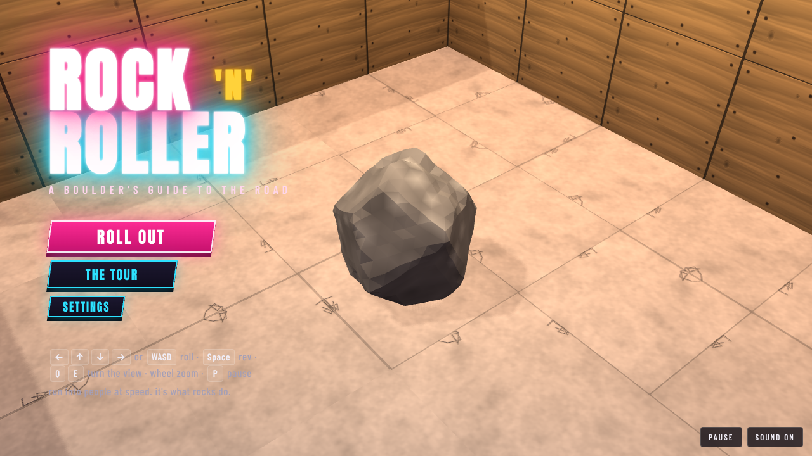
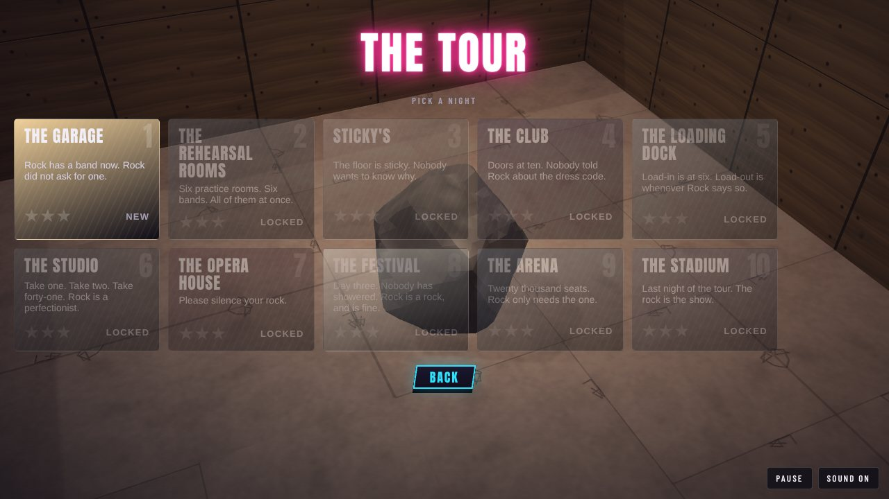

# Rock 'n' Roller

You are a boulder on tour. Roll through ten venues, from a garage to a stadium,
and run into the annoying people you find at a gig, fast enough to smash them.
Every venue has its own light show, and all of it keeps the beat of the band
that is playing in it.

Rock is [Rock](https://github.com/h1ddenpr0cess20/rock)'s boulder: the same
shape, granite and colours (`src/boulder.js` is its geometry), sampled more
finely so the faces are crisp and the grain shows up close. The renderer,
physics, tiled venues and camera come from
[dungeon-roller](https://github.com/h1ddenpr0cess20/dungeon-roller).




## Run

```sh
git clone https://github.com/h1ddenpr0cess20/rocknroller
cd rocknroller
npm install
npm run dev               # → http://localhost:5173
```

It is a static page: no server, no keys. `npm run build` puts it in `dist/`,
which runs from any folder or path. It uses WebGPU where the browser has it and
WebGL2 otherwise. Node 22.12 or later.

## Play

| | |
|---|---|
| <kbd>←</kbd><kbd>↑</kbd><kbd>↓</kbd><kbd>→</kbd> or <kbd>WASD</kbd> | Roll. The venues run diagonally across the screen, so hold two at once. |
| <kbd>Space</kbd> or <kbd>Shift</kbd> | **Rev**: hold to charge. Harder push and a higher top speed, until it runs dry. |
| Hold the mouse or a finger | Roll toward the pointer. The further it is from Rock, the harder the push. On a touch screen there is a REV button. |
| <kbd>Q</kbd> <kbd>E</kbd>, or drag with the right mouse button | Turn the view. Dragging up and down tilts it. |
| Mouse wheel, or <kbd>+</kbd> <kbd>−</kbd> | Zoom. |
| Two fingers | Pinch to zoom, twist to turn, drag up or down to tilt. |
| <kbd>C</kbd> | Put the view back. |
| <kbd>Enter</kbd> / <kbd>Space</kbd> | Start, and carry on after a venue. |
| Gamepad | Left stick or d-pad rolls; right stick turns and tilts; shoulder buttons zoom; <kbd>A</kbd>, <kbd>X</kbd> or the right trigger revs; <kbd>Start</kbd> pauses. |
| <kbd>P</kbd> / <kbd>Esc</kbd> | Pause. |
| <kbd>M</kbd> | Sound on or off. |

### Speed is everything

There are no dice. How hard you hit someone depends on how fast you were going
when you hit them, in tiles a second. Everybody has a **toughness**, the speed it
takes to smash them in one go, and a **power**, how much it hurts to bounce off.

| Speed | | What happens |
|---|---|---|
| 1.7 times what it takes (13 at the least) | **Flattened** | Gone, with double the hype. |
| At least their toughness | **Smash** | Gone, and it costs Rock nothing. |
| Over half their toughness | **Bonk** | You both bounce. It costs Rock some of their power, less the closer you were to a smash. |
| Under that | **Tap** | It hurts, all of their power, and they don't move. |

The furniture is fair game too: amps, kits, desks, bars, seats, cases and
racking all go over if Rock comes at them fast enough (the bigger, the faster),
for a little hype. Crowd barriers and the stands are the building, and stay.

Someone who isn't smashed is still worn down: they have as much health as they
have toughness, and a bonk takes off as much as the speed it came at. A bouncer
you can't hit hard enough can be hit twice. The three bosses have a good deal
more health than that, and a smash on one still costs Rock a little.

Rev is how you get the speed. It is held, it drains, and it fills back up while
you are not using it.

### Staying in one piece

- **Integrity** starts at 100. Knocks, zaps, speaker stacks, pyro and falls take it away; **gaffer tape** puts 25 back.
- At nothing, Rock shatters, unless you picked up a **lighter**. Somebody holds it up, the crowd wants an encore, and Rock gets back up on half.
- **Hype** is the score. Picks and road cases are worth a few points; smashing people is worth more, and smashing them one after another builds a combo (up to ×5, kept alive 3.5 seconds at a time) that multiplies what each is worth.

### Stars

Each venue gives up to three, and each one is a thing of its own to go for:

1. **Show up**: get to the stage door.
2. **Crowd-pleaser**: smash three in four of the people in the way.
3. **Collector**: find all three gold records.

Your stars, best hype and best time for each venue are kept in the browser's
local storage (`rocknroller.v1`), and each venue opens when you clear the one
before. The game plays the same with storage blocked.

### What is in the way

- **Gates** across a way on: find the backstage pass in the same venue to lift them.
- **Flimsy panels** (a sheet of ply, drywall, curtain): run at one fast enough and it breaks. Behind them are usually gold records.
- **Speaker stacks, flight cases and chandeliers** come down on the beat. Wait for the moment they go up. Get caught under one and Rock is smashed.
- **Pyro** bursts out of the floor on the beat.
- **Live cable** zaps whatever rolls onto it.
- **Lifts, forklifts and the crowd** carry you across gaps, if you get on when they are waiting. Crowd-surfing, Rock rides on the hands of the people in the pit.
- **Sticky floors** (spilled beer, mud) slow Rock; **belts** carry him; **bumpers** throw him back.

## The tour

Every venue is laid out its own way, not the same rooms in a different paint.

| | Venue | The band | The way through |
|---|---|---|---|
| 1 | **The Garage** | 124 bpm | A band room under fairy lights, the side of the house, a basement. Little brothers and an angry neighbour. Teaches the lot: picks, a gate and its pass, a speaker stack, a sheet of ply with a record behind it. |
| 2 | **The Rehearsal Rooms** | 118 bpm | A block of nine practice rooms opening into each other, a band in each, the PA dropping in some of the doorways. Records in the far rooms, the pass with the A&R man, a locked fire door and a slide down the fire escape. |
| 3 | **Sticky's** | 96 bpm | A dive bar: sticky floor, neon beer signs, a pool table, a jukebox, pinball bumpers, drunks, a bouncer and an 8-ball with a grudge. |
| 4 | **The Club** | 126 bpm | A velvet-rope queue doubling back along the street, a podium dance floor under the tour's only mirror ball, a crowd-surf over the pit, a sticky bar, the VIP rope, and the Promoter, who lunges for his cut. |
| 5 | **The Loading Dock** | 132 bpm | Down the trailer's tail-lift onto a ledge where the belts run toward the edge, a parcel chute, a conveyor sorting hall, the goods lift, warehouse aisles with crates coming off the crane, three forklifts across the bays. |
| 6 | **The Studio** | 100 bpm | A corridor of isolation booths hiding the records and the pass, a live room with a chicane of live cable and kick drums to bounce off, the control room, a stairwell zig-zagging down. |
| 7 | **The Opera House** | 88 bpm | A chandeliered foyer and grand staircase, a balcony over the dark with an opera box, a slalom down the stepped stalls under falling chandeliers, one plank over the pit, and the Maestro, who moves only on the beat. |
| 8 | **The Festival** | 112 bpm | An island with no walls to speak of: a maze of tents under festoons, a mud slide, a boardwalk over the river with no rail, a main-stage field with a crowd barrier and its gate. |
| 9 | **The Arena** | 120 bpm | Turnstiles, a concourse ring round the seating with two ways round and moving walkways, the security office, a gated tunnel down to the show floor, the players' tunnel with the pyro on a timer. |
| 10 | **The Stadium** | 128 bpm | Down from the top of the stands on three long ramps, across the pitch to the sound-desk tower, out along the catwalk over the pit to the Headliner, who stamps and throws Rock back. |

| | |
|---|---|
|  |  |
|  |  |
|  |  |
|  |  |
|  |  |



## The light show

Every venue is lit by a rig (`src/lightshow.js`) that keeps the beat of the band.

| Fixture | What it does |
|---|---|
| **bulb** | A caged bulb: warm, steady, a little flicker. |
| **par** | A PAR can: a coloured wash and a shaft of haze, changing colour on the beat (chase, pulse or rainbow). |
| **spot** | A moving head: a beam and a pool of light that wander the floor. |
| **strobe** | Flashes white on the beat, in bursts. |
| **ball** | A mirror ball: it turns and throws sparkles across the floor, in colours that chase. There is one, in the Club. |
| **laser** | A fan of thin beams, sweeping. |
| **neon** | A word in tube, flickering, fixed to a wall. |
| **chandelier** | Crystal and candle-bulbs on brass arms, warm and swaying: the Opera House. |
| **festoon** | A string of bulbs slung between two posts, taking turns on the beat: the Garage and the Festival. |

The few fixtures nearest Rock become real lights; the rest are baked into the
floor and walls. Strobes never flash more than three times a second, at any
tempo, and **Settings → Strobe lights** turns them down to a glow.

## The band and the people

The music is played live by a small band in Web Audio (`src/music.js`), with no
audio files: drums, bass, rhythm guitar, a lead, and pads and arpeggios where
the venue wants them, in a different style for every venue. The sound effects
are made the same way. The beat clock drives the hazards and the lights.

The people are sculpted in code (`src/models/cast/`) and baked in background
workers while the page loads, so a venue starts with stand-ins and swaps the
real people in as they finish. They share one rig, but each has a build of its
own (`build()` in `humanoid.js`: legs, torso, head, girth, a belly), so a crowd
isn't one body in different clothes. Little brothers, neighbours, drunks,
moshers, hipsters, roadies, merch guys, influencers, metalheads, ushers,
critics, A&R suits, security, bouncers, a mascot, stage divers, camera drones, a
runaway drum and an 8-ball:


And three bosses, each built and fought differently: the Promoter, short and
round, who lunges and then has to get his breath back; the Maestro, impossibly
tall, who moves only on the beat; and the Headliner, a giant with a flying V,
who stamps and throws Rock back.


## Develop

```sh
npm run dev       # the game, with hot reload
npm run build     # a static build in dist/
npm test          # node's test runner
npm run lint
```

The tests cover the rules (smashing, hype, integrity, stars, storage), the light
show maths (including the strobe limit), the physics and camera, and each
venue: every one has to be cleared start to finish, with all three gold
records, by an autopilot (`test/helpers/autopilot.js`) that plans a route, waits
for the speaker stacks and pyro, charges the panels, fetches the passes and
duels the bosses. Every pickup has to be somewhere Rock can reach, smashable
props have to stand up to a nudge and go over at speed, and the mirror ball
and each boss turn up once on the whole tour.

Other things in the box:

```sh
node scripts/map.js 4          # a venue as text (they count from 1); --heights for floor heights
node scripts/bake.js           # bake every model and say what came out
```

`models.html` is a viewer for the sculpted people and props. In the browser
console, `rocknroller.debug` has `venue(i)` to jump to a venue and
`teleport(x, z)` to put Rock somewhere in it.

### Where things are

| | |
|---|---|
| `src/venues/` | The ten venues, each dug a piece at a time with `src/dig.js`: a hall, a room, stairs, a ferry. `helpers.js` has the shared bits. |
| `src/venue.js`, `src/gig.js` | A venue's tiles and what is in them; one step of everything. |
| `src/smash.js`, `src/integrity.js`, `src/hype.js`, `src/rating.js` | The rules. |
| `src/actors.js`, `src/machinery.js` | The people, and the speaker stacks, pyro, lifts, gates and panels. |
| `src/lightshow.js` | The rig. |
| `src/music.js`, `src/audio.js` | The band and the sound effects. |
| `src/models/` | The people and props, sculpted and baked. |
| `src/boulder.js`, `src/rock.js` | Rock: the boulder, and how it squashes and reacts. |
| `src/decor.js`, `src/furniture.js` | The props: amps, kits, bars, desks, seats, racking, stands, barriers, tents. |
| `src/vendor/gfx/` | The renderer. |

## Credits

Rock is [h1ddenpr0cess20/rock](https://github.com/h1ddenpr0cess20/rock). The
engine is [h1ddenpr0cess20/dungeon-roller](https://github.com/h1ddenpr0cess20/dungeon-roller).
Type is Anton and Barlow Condensed, from [Fontsource](https://fontsource.org).
