# Rock 'n' Roller

A granite boulder called Rock goes on tour. Ten venues, from a two-car garage to a stadium on the last night, each one a level to roll down through: smash the annoying people in the way, smash the furniture while you're at it, keep clear of the speaker stacks and the pyro, find the three gold records hidden in every venue, and get to the stage door in one piece.

It runs in the browser (WebGPU, or WebGL 2 where there isn't any), with everything made in code: the venues are dug a piece at a time, the cast and the props are sculpted from signed distance fields and baked in the background, and the band playing under it all is synthesised live with Web Audio and keeps the beat the light show and the hazards follow.

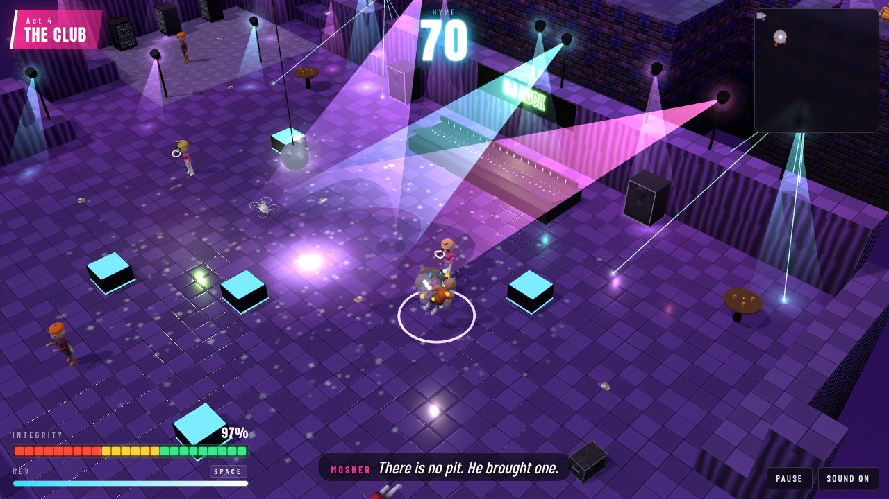

## The tour

| | |
|---|---|
| 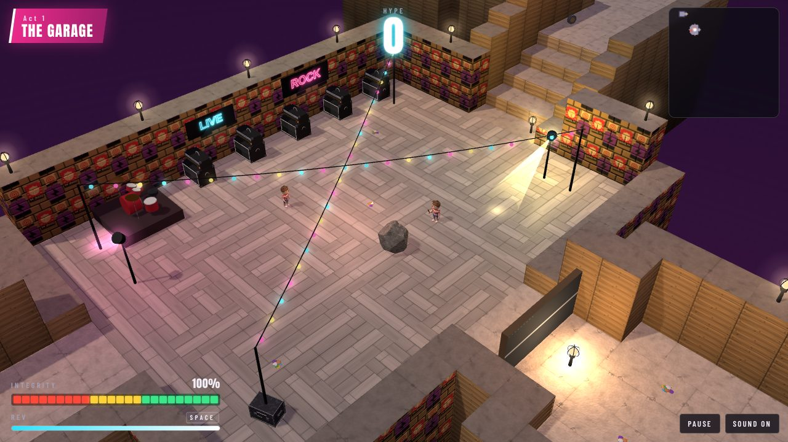 **1. The Garage.** Where Rock starts: a band room under fairy lights, a basement, the neighbour with a broom. Everything is taught here. | 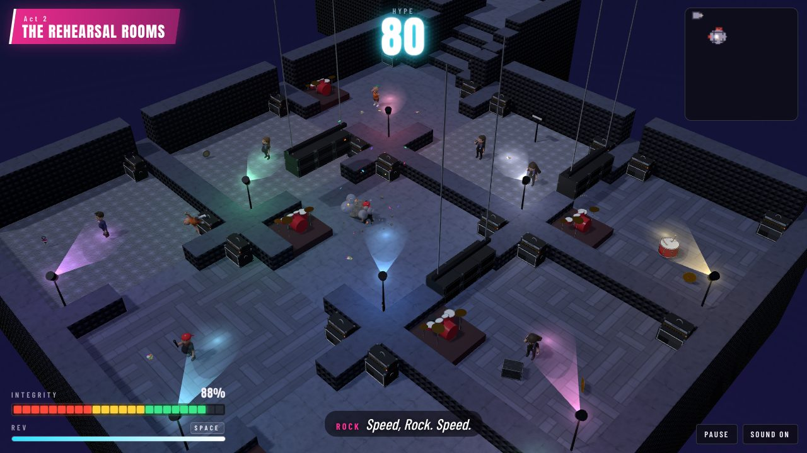 **2. The Rehearsal Rooms.** A block of nine practice rooms, a band in each, the PA dropping in the doorways; a locked fire door and a slide down the fire escape. |
| 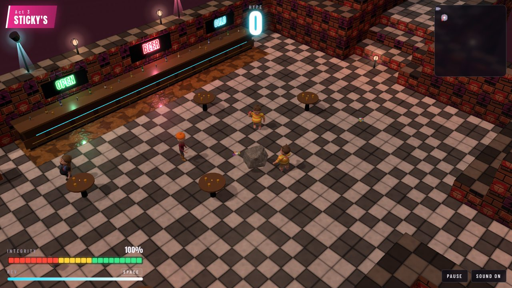 **3. Sticky's.** A dive bar: a floor that slows you down, pinball bumpers, a pool room with an 8-ball that holds a grudge. |  **4. The Club.** A queue doubling back along the street, a podium dance floor under the tour's one mirror ball, a crowd-surf over the pit, and the Promoter, who lunges for his cut. |
| 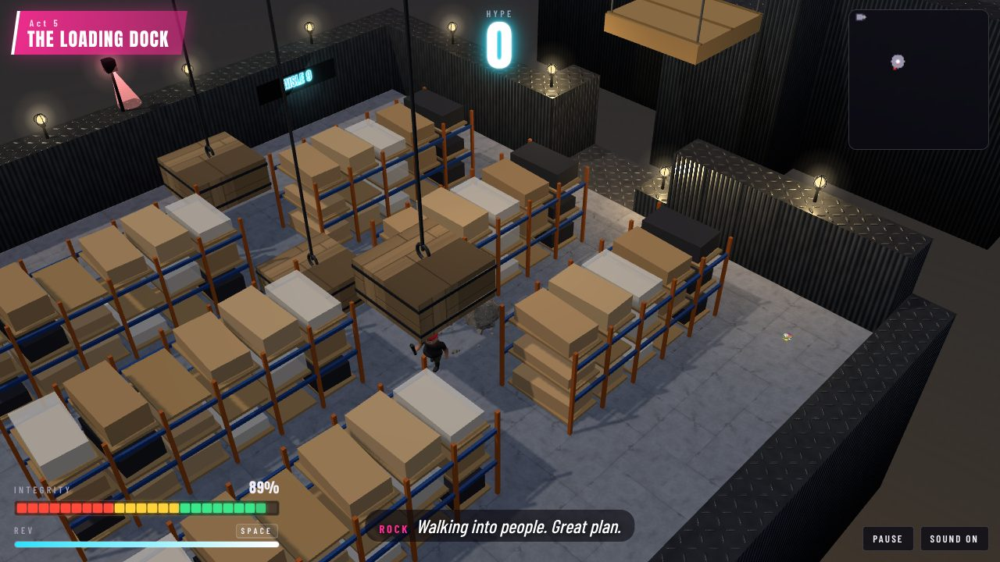 **5. The Loading Dock.** Belts toward the edge, a parcel chute, a goods lift, warehouse racking with crates coming off the crane, forklifts across the bays. | 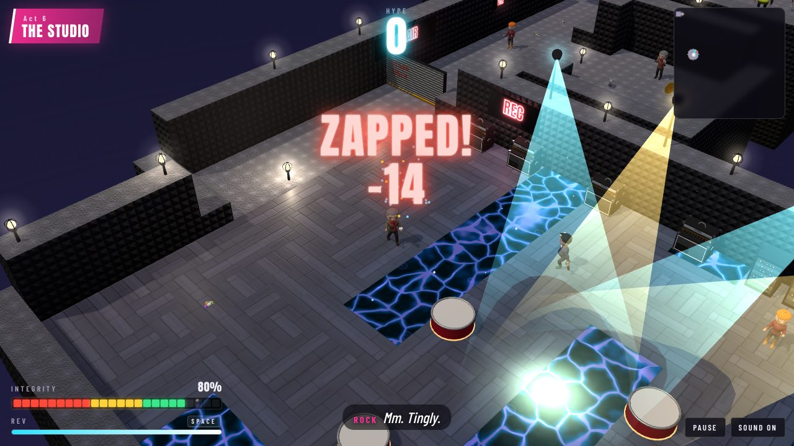 **6. The Studio.** A corridor of isolation booths hiding what you need, a live room with a chicane of live cable, a stairwell zig-zagging down. |
| 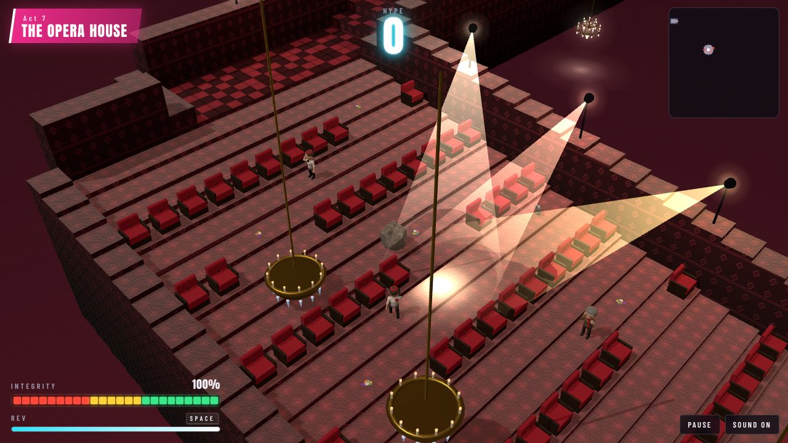 **7. The Opera House.** Chandeliers, a balcony over nothing, a slalom down the stalls, one plank over the pit, and the Maestro, who only moves on the beat. | 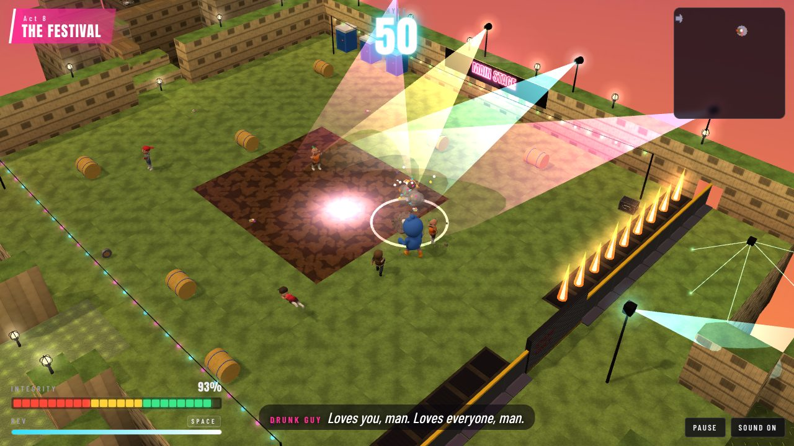 **8. The Festival.** An island with no walls: a campsite maze, a mud slide, a boardwalk with no rail, a main-stage field the size of a level. |
| 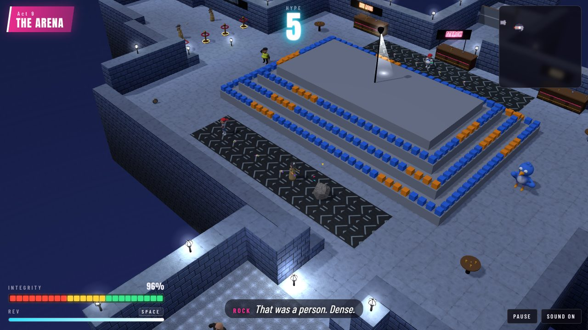 **9. The Arena.** A concourse ring round the seating with two ways round, a gated tunnel down to the show floor, and the players' tunnel with the pyro on a timer. | 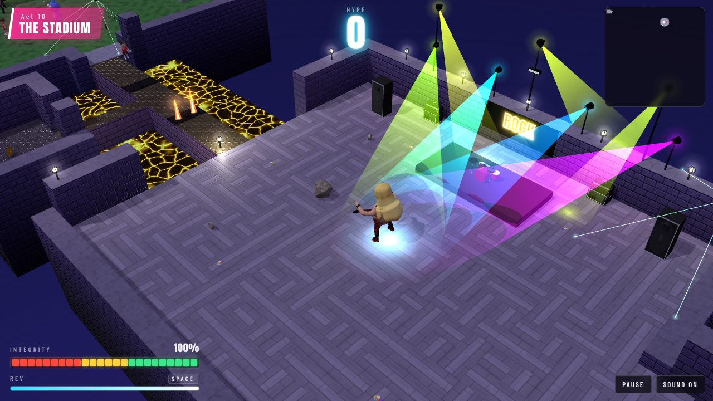 **10. The Stadium.** Down from the top of the stands on the ramps, across the pitch, out along the catwalk to the Headliner, who stamps. |

## The people in the way

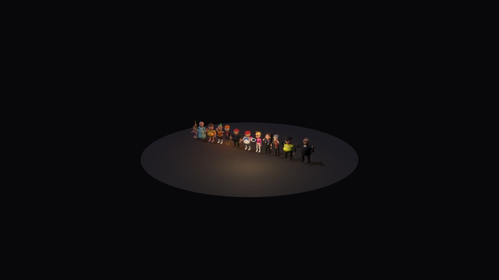

Little brothers, angry neighbours, drunks, moshers, hipsters, roadies, critics, A&R men, security, bouncers, camera drones and more, each with their own build, and three bosses with their own move each:

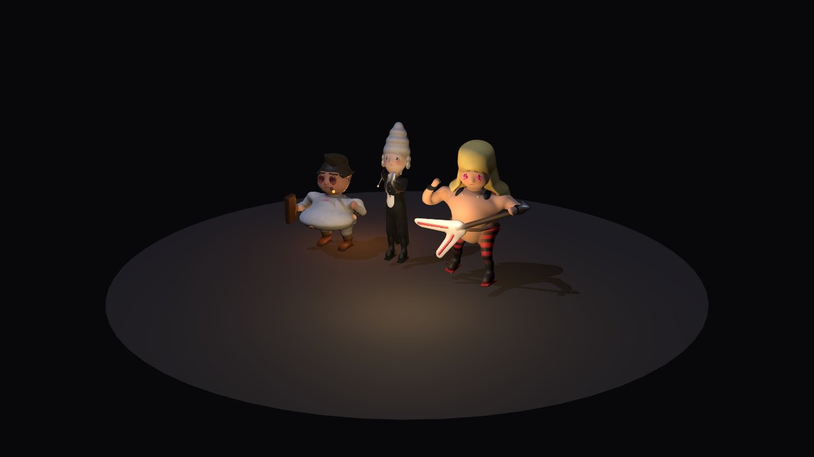

## Playing

- **Roll:** arrow keys or WASD (two at once for the diagonals), or hold the mouse or a finger anywhere and Rock is pushed toward it. A gamepad's left stick works too.
- **Rev:** hold Space or Shift (or the on-screen button, or A on a pad) for a burst of push and speed while the rev meter lasts: that's how you hit hard.
- **View:** Q and E turn it, + and − zoom, C puts it back; or drag with the right mouse button, or pinch and twist.
- **Pause:** P or Escape. **Mute:** M.

Hit people fast enough and they go down in one; too slow and they hurt you back. Picks and road cases are hype, gaff tape holds you together, a lighter is an encore, a pass opens a gate. Three gold records per venue, and a smash on three in four of the people there, are the other two stars.

## Developing

Node 22.12 or later.

```sh
npm install
npm run dev      # the game on http://localhost:5173, the models on /models.html
npm test         # the rules, the physics, and an autopilot that plays every venue through
npm run lint
npm run build
```

- `node scripts/map.js 4` prints venue 4 as text, for laying one out (`--heights` for the floor heights).
- `node scripts/bake.js [name] [detail]` bakes the sculpted models and says how big they came out.
- `/models.html?m=promoter,maestro,headliner` is a turntable for the cast and the props.

The venues are in `src/venues/`, each dug with `src/dig.js`; the cast is in `src/models/cast/`, all of them on the humanoid rig in `humanoid.js` with a build of their own; the band is `src/music.js`. The test in `test/venues.test.js` drives every venue to the stage door, picking up every record, and checks that everything lying about can be reached.
